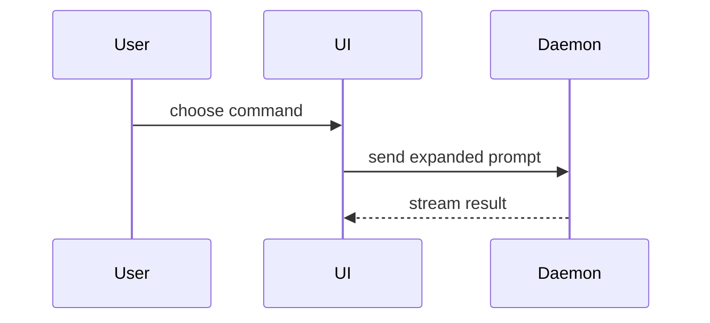

# Summary views

One example per view. Pick the smallest one that makes the key point clear.

## Logic or an algorithm: pseudocode

```text
on(save)
  if content is unchanged
    return cached result
  write new content
  return fresh result
```

## Runtime control flow: a call tree

```text
submitForm
  createSession
    persistPrompt
    launchAgent
  navigateToSession
```

## UI structure: a component tree

Include the state and module boundaries that matter.

```tsx
<SessionPage>            // apps/example/src/routes/session.tsx
  useSessionEvents()
  <SessionToolbar>
    <RunSkillButton />   // packages/ui
```

## File responsibility or a broad refactor: a shallow file tree

```text
src/
├── commands/       # parses user actions
├── sessions/       # owns session state
└── transport/      # sends API requests
```

## Component interaction, control flow or data flow: Mermaid



## What changes in an existing shape: a diff sketch

Match the diff's shape to the topic.

A component change:

```diff
 <SessionPage>
   useSessionEvents()
   <SessionToolbar>
+    <RunSkillButton />
   <SessionTimeline>
+    <SkillResultCard />
```

A file-layout change:

```diff
 src/
 ├── commands/
+│   └── show-me.ts       # expands the command
 ├── sessions/
-└── transport.ts
+└── transport/
+    ├── client.ts
+    └── stream.ts
```

A call-tree change:

```diff
 submitForm
   createSession
     persistPrompt
+    expandSkillMention
     launchAgent
-  navigateToSession
+  navigateToSession
+    subscribeToEvents
```

A state or control-flow change:

```diff
 on(save)
-  write content
+  if content is unchanged
+    return cached result
+  write new content
+  invalidate cache
```

## The whole block

Show it in full when most of it is new, when omitted context would hide ownership or order, or when the reader needs a copyable target shape:

```ts
function expandSkill(command: string): string {
  const skillName = command.slice(1);
  return `use the ${skillName} skill`;
}
```
